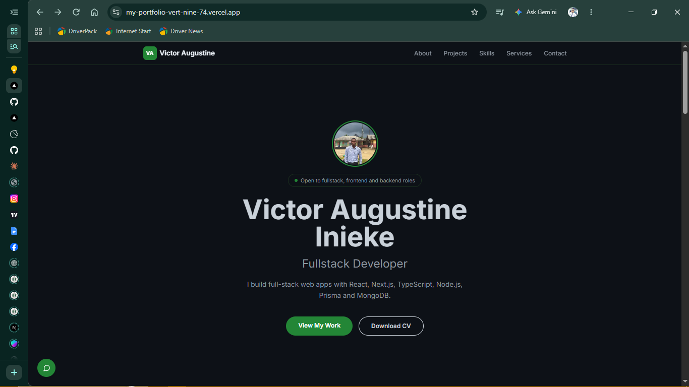

# Victor Augustine Inieke | Portfolio

My personal developer portfolio: who I am, what I've built, the services I offer, and how to reach me.

🔗 **Live site:** https://my-portfolio-vert-nine-74.vercel.app/



## Pages and sections

- **Home:** hero, featured projects, skills, services, and contact
- **About:** bio, quick facts, and a timeline of my background

## Tech stack

| Area | Tech |
|---|---|
| Framework | Next.js (App Router) |
| Language | TypeScript |
| Styling | Tailwind CSS |
| Font | Inter |
| Deployment | Vercel |

The design is a dark, GitHub-inspired theme (`#0d1117` background, `#238636` accent).

## Project structure

```
app/
  page.tsx          # Home: Hero, Projects, Skills, Services, Contact
  about/page.tsx    # About: bio, quick facts, timeline
components/         # Shared UI (Footer, etc.)
utils/navbar/       # Navbar
```

## Run it locally

Requires Node.js 18+.

```bash
git clone https://github.com/VeekAustin/myPortfolio.git
cd myPortfolio
npm install
npm run dev
```

Open http://localhost:3000.

## Deploying

The site is deployed on Vercel. Pushing to `main` triggers a new deployment.

## Featured projects

- **[Trackr](https://trackr-web-sigma.vercel.app/):** full-stack progress tracker (Next.js, Express, MongoDB). [Web repo](https://github.com/VeekAustin/trackr-web) · [API repo](https://github.com/VeekAustin/trackr-api)

## Contact

**Victor Augustine Inieke** · Port Harcourt, Nigeria
[GitHub](https://github.com/VeekAustin) · [email](iniekevictor@gmail.com)